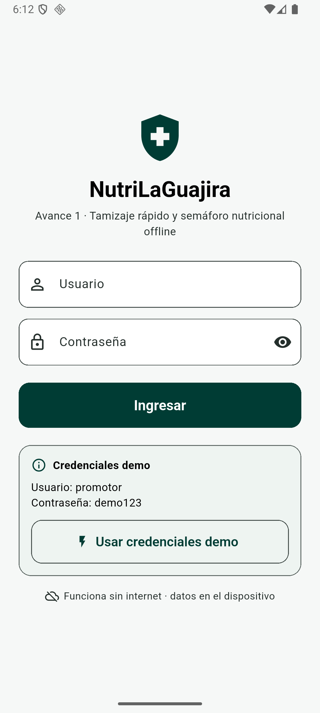
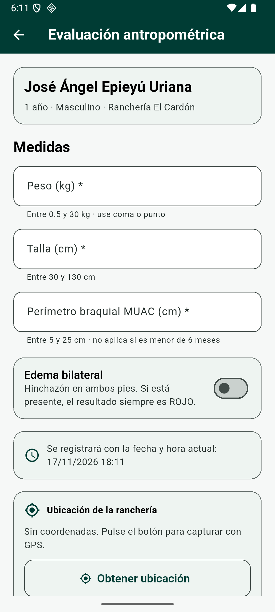
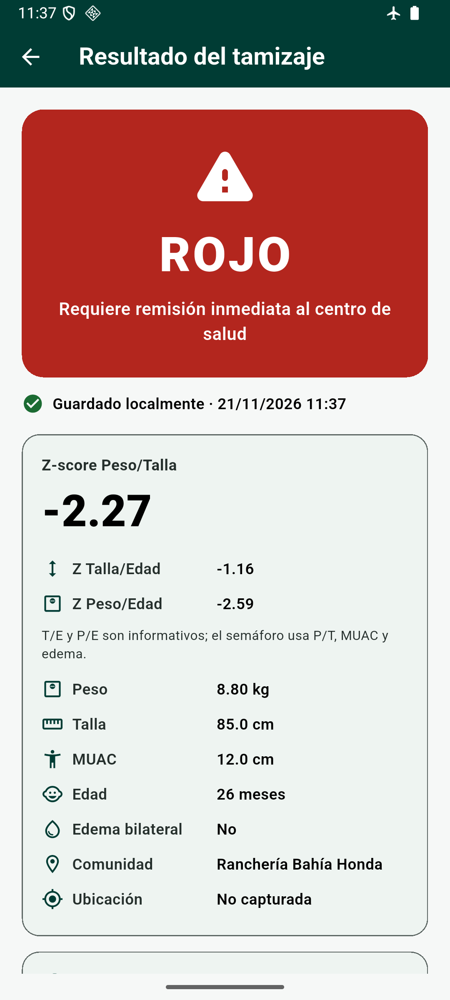
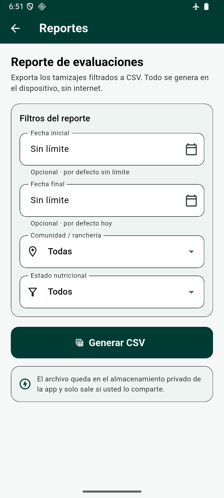
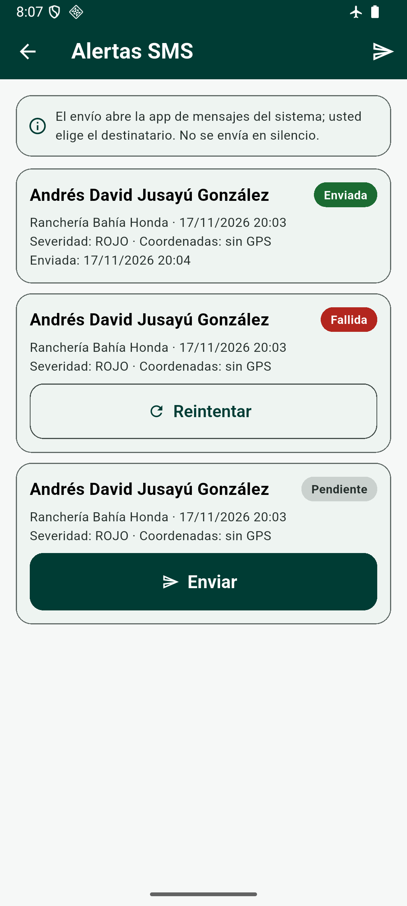
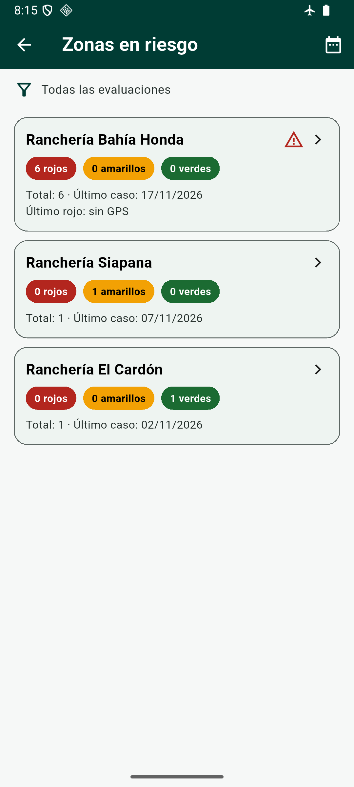

# Guía rápida del promotor — NutriLaGuajira

**Versión de la app:** `v0.4.0-sprint4` · **Requiere:** Android 7.0 o superior
· **Funciona sin internet**

> Esta guía es un **borrador para el piloto de 2027-1**. Si algo no coincide con
> lo que ves en el teléfono, avisa al equipo: la guía se corrige con tu
> retroalimentación.

---

## 1. Antes de salir a la ranchería

| ✔ | Revisa |
|---|---|
| ☐ | Teléfono **cargado al 100 %** y power bank en la mochila. |
| ☐ | La app **NutriLaGuajira** abre y muestra el login. |
| ☐ | Tienes la **cinta métrica** y la **balanza** calibradas. |
| ☐ | Tienes los **consentimientos impresos** y bolígrafo. |
| ☐ | El teléfono tiene **PIN** activo y no lo lleva nadie más. |
| ☐ | Sabes a qué **número institucional** se envía la alerta (nunca a un contacto personal). |

**No necesitas datos móviles ni wifi.** Si el teléfono está en modo avión, la app
funciona igual. GPS es opcional: si no hay señal, el tamizaje se guarda sin
coordenadas y lo indica como "GPS: no capturado".

---

## 2. Entrar

1. Abre **NutriLaGuajira**.
2. Elige una de las dos formas:

| Forma | Credenciales | ¿Sincroniza? |
|---|---|---|
| **Cuenta demo (local)** | `promotor` / `demo123` | **No** — todo queda en el teléfono |
| **Cuenta institucional** | correo y contraseña creados en Firebase | **Sí** — copia a Google Cloud |

3. Toca **Ingresar**.

> La cuenta demo sirve para probar sin internet. La cuenta institucional permite
> el respaldo y que la brigada vea las alertas ROJAS, pero **envía datos de los
> niños a la nube**: úsala solo si la familia lo autorizó (ver el
> consentimiento).
>
> El login con correo necesita **internet la primera vez** en ese teléfono. Si
> olvidas la contraseña, la coordinación la restablece; no la compartas.

---

## 3. Registrar un niño (solo la primera vez)

**Menú → Nuevo tamizaje → "Registrar niño"** (o el botón de agregar).

Datos que pide: nombres, apellidos, documento, fecha de nacimiento, sexo,
tutor/acudiente y **ranchería**. La edad en meses se calcula sola.

- Escribe la ranchería **siempre igual** (por ejemplo `R1` en el piloto): así los
  reportes y las zonas en riesgo agrupan bien.
- El documento es opcional si la familia no lo tiene a mano; no inventes números.

---

## 4. Hacer el tamizaje

1. **Menú → Nuevo tamizaje** y elige al niño de la lista.
2. Pesa al niño **sin zapatos y con ropa ligera**; anota los kg (acepta coma o
   punto: `8,8` = `8.8`).
3. Mide la talla **de pie** (mayores de 2 años) o **acostado** (menores), en cm.
4. Mide el **perímetro braquial (MUAC)** en el brazo izquierdo, punto medio.
   *Solo se usa desde los 6 meses; en menores la app lo ignora y lo avisa.*
5. Marca **edema bilateral** solo si al presionar el dorso del pie queda la
   marca (fóvea) en **los dos pies**.
6. Opcional: **Capturar GPS** (mejora el reporte de zonas).
7. Toca **Calcular**.

---

## 5. Leer el resultado

La pantalla muestra el **semáforo**, el **Z Peso/Talla** y la recomendación.

| Color | Qué significa | Qué haces |
|---|---|---|
| 🟢 **VERDE** | Peso adecuado para la talla | Refuerza alimentación y controles; despide con la recomendación. |
| 🟡 **AMARILLO** | Riesgo de desnutrición aguda | Explica a la familia, agenda control y avisa al enlace comunitario. |
| 🔴 **ROJO** | Desnutrición aguda o edema bilateral | **Refiere el mismo día** por el canal institucional y registra la referencia en la bitácora. |

**Reglas que debes conocer:**

- **Edema bilateral = ROJO**, aunque el Z salga normal. No lo dudes: refiere.
- Si el Z y el MUAC no coinciden, la app toma **el criterio más grave**.
- **Z Talla/Edad** y **Z Peso/Edad** se muestran como información adicional
  (marcados "informativo"). **El semáforo NO los usa**: se basa en Peso/Talla,
  MUAC y edema.

> **Aviso importante.** Las tablas de referencia de esta versión son **DEMO**
> (académicas) y están marcadas dentro de la app. No sustituyen el diagnóstico
> ni la norma oficial. Para la fase clínica deben reemplazarse por las tablas
> OMS (Gate 1 del roadmap).

Toca **Ver criterios** si quieres mostrarle a la familia de dónde sale el
resultado (mediana, DE, fórmula).

---

## 6. Después del tamizaje

### 6.1 Historial y detalle

**Menú → Historial** muestra los tamizajes del más reciente al más antiguo, con
su color. Toca uno para ver el detalle, los criterios y las coordenadas.

### 6.2 Reportes (CSV y PDF)

**Menú → Reportes** → elige fechas, ranchería y estado (riesgo / desnutrición
aguda) → **Generar CSV** o **PDF**.

- El **CSV** se abre en Excel con tildes correctas.
- El **PDF** incluye el resumen por color, los casos ROJO con coordenadas y la
  nota de que las tablas son DEMO. Se puede **compartir** o **abrir**.
- Los archivos quedan **en el teléfono**, no se suben a internet.

### 6.3 Alertas por SMS

Cada tamizaje **ROJO** se encola automáticamente. En **Menú → Alertas**:

1. Toca **Enviar**: se abre tu app de mensajes con el texto ya escrito.
2. **Elige el destinatario institucional** y envía.
3. Si falla, la alerta queda **FALLIDA** y puedes tocar **Reintentar**.

La app **no envía sola** y **no pide permiso de SMS**: tú eliges el destinatario.

### 6.4 Sincronización (solo con cuenta institucional)

En el **Home** hay una tarjeta de sincronización:

| Estado | Qué significa | Qué haces |
|---|---|---|
| **Todo sincronizado** | Los datos ya están en la nube | Nada |
| **Pendientes: N** | Hay N registros esperando red | Espera a tener señal o toca la nube para reintentar |
| **Sin conexión** | No hay red; se sigue trabajando igual | Sigue tamizando: se guarda en el teléfono |
| **Sincronizando…** | Está subiendo | No cierres la app |

Se sincroniza solo al entrar, al guardar, al volver a la app y al recuperar
señal. Si falla, **no pierdes nada**: queda pendiente y se reintenta.

### 6.5 Zonas en riesgo

**Menú → Zonas en riesgo** consolida por ranchería, ordenado por criticidad
(rojos primero), con el detalle de los casos ROJO y un botón para copiar las
coordenadas.

---

## 7. Si algo sale mal

| Problema | Qué hacer |
|---|---|
| "La talla no es válida" | Revisa que esté en cm (no metros) y dentro del rango. |
| "El niño supera los 59 meses" | La app es para menores de 5 años; usa el formato institucional. |
| No captura GPS | Normal sin señal. El tamizaje se guarda sin coordenadas. |
| La app se cerró | Ábrela otra vez: los datos guardados siguen ahí. Vuelve a hacer el tamizaje solo si no aparece en el historial. |
| Se equivocó un dato | **Hoy no se puede editar ni borrar** desde la app: registra el tamizaje correcto y anótalo en la bitácora. |
| No hay batería | Carga con el power bank; evita hacer tamizajes con menos de 15 %. |
| Un ROJO no se pudo referir | Llama a la coordinación **el mismo día** y regístralo como incidente. |

---

## 8. Cuidado de los datos (obligatorio)

- El teléfono guarda **datos de menores**. No lo prestes, no lo dejes sin
  vigilancia, mantenlo con PIN.
- **No envíes el CSV ni capturas con nombres** por WhatsApp personal. Para
  compartir, usa el canal del equipo y, si es para análisis, envía la versión
  **sin nombres**.
- El **SMS de alerta incluye el nombre del niño**: envíalo **solo** al número
  institucional.
- Al terminar el piloto, el equipo **borra los datos** del teléfono y conserva
  solo el archivo anonimizado.

---

## 9. Lo que la app NO hace (para que no te sorprenda)

- No diagnostica: **tamiza y alerta**.
- **Sincroniza solo con cuenta institucional** (Google Cloud / Firestore). Con
  la cuenta demo, nada sale del teléfono.
- No descarga datos: si cambias de teléfono, el historial no se restaura solo.
- No reemplaza la tabla OMS oficial (usa tablas **DEMO**).
- No edita ni borra evaluaciones.
- No funciona en iPhone.
- No envía SMS por sí sola: abre tu app de mensajes.

---

## 10. A quién avisar

| Situación | Contacto |
|---|---|
| Caso ROJO sin canal de referencia | Coordinación del piloto (teléfono en la ficha de la ranchería) |
| Duda sobre el resultado | Enlace de Uniguajira |
| App con error o dato perdido | Coordinación técnica + bitácora (F5) |
| Solicitud de la familia sobre sus datos | Coordinación (Ley 1581) |

**Guarda esta guía en el teléfono** (PDF o foto) por si la necesitas sin señal.
