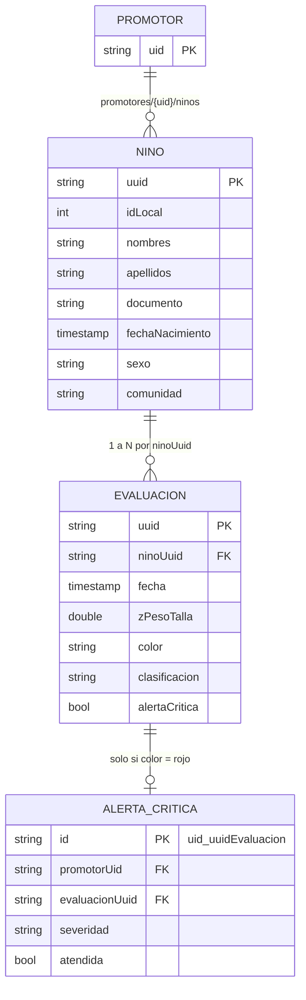
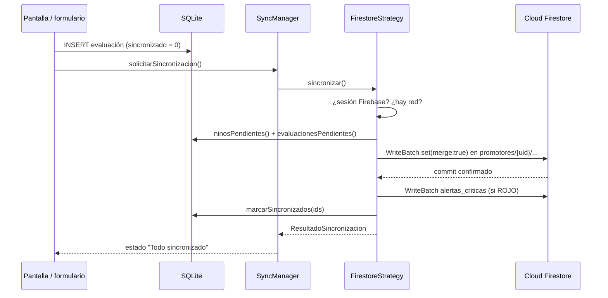

# Diseño de la base de datos Firestore — NutriLaGuajira

Documento de diseño de la capa de sincronización implementada en esta entrega.
Complementa a [`README_FIREBASE.md`](README_FIREBASE.md).

> **Principio rector:** SQLite es la fuente de verdad local. Firestore es el
> canal de transporte y respaldo. Ningún cálculo clínico (Z-score, semáforo)
> depende de la nube.

---

## 1. Panorama de colecciones

```text
promotores/{uid}                        ← documento padre implícito (no se escribe)
├── ninos/{uuidNino}
│   ├── nombres, apellidos, documento, fechaNacimiento, sexo, tutor,
│   │   comunidad, createdAt, uuid, ...
│   └── (1 : N) evaluaciones
└── evaluaciones/{uuidEvaluacion}
    ├── ninoUuid  ────────────────►  ninos/{uuidNino}
    ├── fecha, edadMeses, pesoKg, tallaCm, muacCm, edema
    ├── zPesoTalla, zTallaEdad, zPesoEdad
    ├── clasificacion, color, observacion
    ├── lat, lng, alertaCritica
    └── promotorUid, actualizadoEnLocal, sincronizadoEn

alertas_criticas/{uid}_{uuidEvaluacion}   ← colección global plana
├── promotorUid, evaluacionUuid, ninoUuid, ninoNombre, comunidad
├── severidad: "ROJO", clasificacion, color, fecha
├── edadMeses, pesoKg, tallaCm, muacCm, edema, lat, lng
└── atendida: false, origen
```

Diagrama de relación:



Observaciones del modelo:

- **No se escribe el documento `promotores/{uid}`**: existen sus
  subcolecciones. Las reglas usan `{document=**}` para cubrirlas.
- **El id del documento es el `uuid` local**, no el `id` autoincremental de
  SQLite. Así dos dispositivos no colisionan y reintentar es idempotente.
- **`ninos` y `evaluaciones` están anidadas por promotor** para que las reglas
  de seguridad aíslen los datos con una sola condición (`uid == auth.uid`).
- **`alertas_criticas` es global** para que la brigada central pueda escuchar
  una sola colección sin recorrer todas las carpetas de promotores.
- Firestore no impone esquema; este documento es el **contrato** que escribe
  `FirestoreStrategy`.

---

## 2. Esquema detallado

### 2.1 `promotores/{uid}/ninos/{uuidNino}`

| Campo | Tipo | Obligatorio | Origen SQLite | Descripción |
|---|---|---|:---:|---|
| `idLocal` | int | sí | `ninos.id` | Id autoincremental local (trazabilidad) |
| `uuid` | string | sí | `ninos.uuid` | Id estable del documento |
| `nombres` | string | sí | `nombres` | Nombres del infante |
| `apellidos` | string | sí | `apellidos` | Apellidos |
| `documento` | string | sí | `documento` | Documento único del infante |
| `fechaNacimiento` | timestamp | sí | `fecha_nacimiento` | Fecha de nacimiento |
| `sexo` | string | sí | `sexo` | `"M"` o `"F"` |
| `tutor` | string | sí | `tutor` | Nombre del tutor |
| `comunidad` | string | sí | `comunidad` | Ranchería / comunidad |
| `createdAt` | timestamp | sí | `created_at` | Alta local |
| `actualizadoEnLocal` | string ISO-8601 | sí | `updated_at` | Última edición local |
| `promotorUid` | string | sí | sesión | UID de Firebase del autor |
| `origen` | string | sí | constante | `"nutrilaguajira-movil"` |
| `sincronizadoEn` | timestamp | sí | servidor | Hora de llegada a Firestore (`FieldValue.serverTimestamp()`) |

### 2.2 `promotores/{uid}/evaluaciones/{uuidEvaluacion}`

| Campo | Tipo | Obligatorio | Origen SQLite | Descripción |
|---|---|---|:---:|---|
| `idLocal` | int | sí | `evaluaciones.id` | Id local |
| `uuid` | string | sí | `evaluaciones.uuid` | Id del documento |
| `ninoUuid` | string | sí | `ninos.uuid` | Relación con el infante |
| `ninoNombre` | string | no | JOIN | Nombre completo (desnormalizado para reportes) |
| `comunidad` | string | no | JOIN | Ranchería (desnormalizada) |
| `fecha` | timestamp | sí | `fecha` | Fecha/hora del tamizaje |
| `edadMeses` | int | sí | `edad_meses` | Edad en meses al tamizar |
| `pesoKg` | double | sí | `peso_kg` | Peso |
| `tallaCm` | double | sí | `talla_cm` | Talla |
| `muacCm` | double | sí | `muac_cm` | Perímetro braquial |
| `edema` | bool | sí | `edema` | Edema bilateral |
| `zPesoTalla` | double | sí | `z_peso_talla` | Z Peso/Talla (clasifica) |
| `zTallaEdad` | double | no | `z_talla_edad` | Informativo |
| `zPesoEdad` | double | no | `z_peso_edad` | Informativo |
| `clasificacion` | string | sí | `clasificacion` | `VERDE` / `AMARILLO` / `ROJO` |
| `color` | string | sí | `color` | `verde` / `amarillo` / `rojo` |
| `observacion` | string | sí | `observacion` | Criterios aplicados (texto) |
| `lat` | double | no | `lat` | GPS opcional |
| `lng` | double | no | `lng` | GPS opcional |
| `alertaCritica` | bool | sí | derivado | `true` si `color == "rojo"` |
| `actualizadoEnLocal` | string ISO-8601 | sí | `updated_at` | Última edición local |
| `promotorUid` | string | sí | sesión | UID del autor |
| `origen` | string | sí | constante | `"nutrilaguajira-movil"` |
| `sincronizadoEn` | timestamp | sí | servidor | Hora de llegada a Firestore |

### 2.3 `alertas_criticas/{uid}_{uuidEvaluacion}`

| Campo | Tipo | Obligatorio | Descripción |
|---|---|:---:|---|
| `promotorUid` | string | sí | Autor; validado por las reglas |
| `ninoUuid` | string | sí | Infante relacionado |
| `ninoNombre` | string | no | Nombre completo |
| `comunidad` | string | no | Ranchería |
| `evaluacionUuid` | string | sí | Evaluación que originó la alerta |
| `severidad` | string | sí | `"ROJO"` |
| `clasificacion` | string | sí | `"ROJO"` |
| `color` | string | sí | `"rojo"` |
| `fecha` | timestamp | sí | Fecha del tamizaje |
| `edadMeses` | int | sí | Edad |
| `pesoKg` | double | sí | Peso |
| `tallaCm` | double | sí | Talla |
| `muacCm` | double | sí | MUAC |
| `edema` | bool | sí | Edema bilateral |
| `lat` / `lng` | double | no | GPS si se capturó |
| `atendida` | bool | sí | Inicia en `false` |
| `origen` | string | sí | `"nutrilaguajira-movil"` |

Además existe un camino alternativo: `FirestoreStrategy.enviar(AlertaPendiente)`
(para usar Firestore como canal de la cola de alertas) escribe en la misma
colección con id `{uid}_alerta_{idAlertaLocal}` y campos `mensaje`,
`evaluacionIdLocal`, `infanteIdLocal`, `severidad`, `fecha`, `lat`, `lng`,
`atendida`, `origen: "alerta_sms"`.

### 2.4 Colecciones que **no** se crean

- `usuarios`: el login vive en SQLite y en Firebase Auth.
- `referencias`/`who_*`: tablas de referencia clínica, no se suben.
- `alertas_pendientes` (SMS): cola local; solo se publica la alerta crítica.
- No hay documentos padre `promotores/{uid}` ni `promotores` como colección
  raíz con datos.

---

## 3. Ejemplo real de documento sincronizado

Este es el documento que quedó en Firestore durante la prueba con la cuenta
`correoprueba@nutri.laguajira.com` (uid `YDWkkHh0Z4PhbCC010aL5KIXavy2`):

```json
{
  "name": "projects/nutrilaguajira/databases/(default)/documents/promotores/YDWkkHh0Z4PhbCC010aL5KIXavy2/evaluaciones/eval-660f3a6d4ac62-b81c9bfec1a0169c",
  "fields": {
    "idLocal": 5,
    "uuid": "eval-660f3a6d4ac62-b81c9bfec1a0169c",
    "ninoUuid": "nino-660f38d9a422a-c418932c06556783",
    "ninoNombre": "Andrés David Jusayú González",
    "comunidad": "Ranchería Bahía Honda",
    "fecha": "2026-11-23T15:57:32.537986Z",
    "edadMeses": 26,
    "pesoKg": 8.8,
    "tallaCm": 85,
    "muacCm": 12,
    "edema": false,
    "zPesoTalla": -2.2727272727272725,
    "zTallaEdad": -1.1612476186359584,
    "zPesoEdad": -2.586158740492418,
    "clasificacion": "ROJO",
    "color": "rojo",
    "observacion": "P/T: ... | Z Peso/Talla = -2.27 -> ROJO. | ...",
    "alertaCritica": true,
    "actualizadoEnLocal": "2026-11-23T15:57:32.539076",
    "promotorUid": "YDWkkHh0Z4PhbCC010aL5KIXavy2",
    "origen": "nutrilaguajira-movil",
    "sincronizadoEn": "2026-11-23T16:05:57.427Z"
  }
}
```

Y la alerta crítica correspondiente:

```json
{
  "name": "projects/nutrilaguajira/databases/(default)/documents/alertas_criticas/YDWkkHh0Z4PhbCC010aL5KIXavy2_eval-660f3a6d4ac62-b81c9bfec1a0169c",
  "fields": {
    "promotorUid": "YDWkkHh0Z4PhbCC010aL5KIXavy2",
    "evaluacionUuid": "eval-660f3a6d4ac62-b81c9bfec1a0169c",
    "ninoUuid": "nino-660f38d9a422a-c418932c06556783",
    "ninoNombre": "Andrés David Jusayú González",
    "comunidad": "Ranchería Bahía Honda",
    "severidad": "ROJO",
    "clasificacion": "ROJO",
    "color": "rojo",
    "fecha": "2026-11-23T15:57:32.537986Z",
    "edadMeses": 26,
    "pesoKg": 8.8,
    "tallaCm": 85,
    "muacCm": 12,
    "edema": false,
    "atendida": false,
    "origen": "nutrilaguajira-movil"
  }
}
```

---

## 4. Correspondencia SQLite → Firestore

### 4.1 `ninos` (SQLite v5)

```sql
CREATE TABLE ninos (
  id INTEGER PRIMARY KEY AUTOINCREMENT,
  nombres TEXT NOT NULL,
  apellidos TEXT NOT NULL,
  documento TEXT NOT NULL UNIQUE,
  fecha_nacimiento TEXT NOT NULL,
  sexo TEXT NOT NULL,
  tutor TEXT NOT NULL,
  comunidad TEXT NOT NULL,
  created_at TEXT NOT NULL,
  uuid TEXT,
  sincronizado INTEGER NOT NULL DEFAULT 0,
  updated_at TEXT
);
```

- `uuid` se genera al insertar (`generarUuidLocal('nino')`).
- `sincronizado = 0` en cada inserción o edición.
- `updated_at` guarda la última edición local.
- La primera sincronización de una instalación antigua rellena `uuid` con
  `'nino-' || id` (migración v5).

### 4.2 `evaluaciones` (SQLite v5)

```sql
CREATE TABLE evaluaciones (
  id INTEGER PRIMARY KEY AUTOINCREMENT,
  nino_id INTEGER NOT NULL,
  fecha TEXT NOT NULL,
  edad_meses INTEGER NOT NULL,
  peso_kg REAL NOT NULL,
  talla_cm REAL NOT NULL,
  muac_cm REAL NOT NULL,
  edema INTEGER NOT NULL DEFAULT 0,
  z_peso_talla REAL NOT NULL,
  clasificacion TEXT NOT NULL,
  color TEXT NOT NULL,
  observacion TEXT NOT NULL DEFAULT '',
  sincronizado INTEGER NOT NULL DEFAULT 0,
  lat REAL,
  lng REAL,
  z_talla_edad REAL,
  z_peso_edad REAL,
  uuid TEXT,
  updated_at TEXT
);
```

- `uuid` se genera al insertar (`generarUuidLocal('eval')`).
- `sincronizado = 0` en cada inserción.
- El documento remoto se construye con un JOIN a `ninos` para obtener
  `nino_uuid`, `nino_nombre` y `comunidad`.

### 4.3 Conversiones de tipo

| SQLite | Firestore | Nota |
|---|---|---|
| `INTEGER` 0/1 | `bool` | `edema`, `alertaCritica`, `atendida` |
| `TEXT` ISO-8601 (`fecha`, `updated_at`, `created_at`) | `Timestamp` | Se pasa `DateTime` al SDK |
| `REAL` | `double` | Peso, talla, MUAC, Z-scores, lat/lng |
| `TEXT` (`color`, `clasificacion`) | `string` | Se mantiene la clave y la etiqueta |
| `uuid` | id del documento | No se usa el `id` autoincremental |

---

## 5. Flujo de sincronización implementado



Pasos concretos (`lib/services/firestore_strategy.dart`):

1. Verifica `AlmacenNube.disponible` (Firebase inicializado + sesión Auth).
2. Verifica conectividad con `connectivity_plus` (salvo `forzar: true`).
3. Consulta en SQLite:
   - `ninosPendientes()` → `WHERE sincronizado = 0`
   - `evaluacionesPendientes()` → JOIN con `ninos`, `WHERE sincronizado = 0`
4. Construye `DocumentoNube` con rutas completas:
   - `promotores/{uid}/ninos/{uuid}`
   - `promotores/{uid}/evaluaciones/{uuid}`
   - `alertas_criticas/{uid}_{uuidEvaluacion}` (si `color == "rojo"`)
5. `FirestoreAlmacen.guardarLote()`:
   - Agrupa en lotes de **400** (el máximo de Firestore es 500).
   - `batch.set(doc, datos, SetOptions(merge: true))`.
   - Añade `sincronizadoEn: FieldValue.serverTimestamp()`.
   - `commit()` con timeout de **30 s**.
6. Solo si el commit se confirma, `Repositorio.marcarSincronizados()` pone
   `sincronizado = 1` y `updated_at = ahora` en SQLite.
7. Cualquier error se captura con `debugPrint`; los pendientes se conservan y
   se reintentan al recuperar red, al volver a la app o al pulsar la nube.

### Disparadores de la sincronización

| Disparador | Dónde |
|---|---|
| Login exitoso | `login_screen.dart` → `AppServices.sync.iniciar()` |
| Guardar infante | `nino_form_screen.dart` |
| Guardar evaluación | `evaluacion_form_screen.dart` |
| Pasar de offline a online | `connectivity_plus` en `SyncManager` |
| Volver a la app | `WidgetsBindingObserver` en `HomeScreen` |
| Toque manual en la nube | Tarjeta de sincronización del Home |

### Idempotencia y concurrencia

- El id del documento es estable (`uuid`): reintentar no duplica.
- `set(merge: true)` actualiza solo los campos enviados.
- `marcarSincronizados()` se ejecuta únicamente después del `commit`.
- `SyncManager` evita ejecuciones simultáneas (`_enCurso`).
- Conflicto entre dispositivos: **última escritura gana** en el servidor;
  `actualizadoEnLocal` permite auditar y `sincronizadoEn` registra la llegada.
- En esta fase la app **no descarga** datos remotos ni fusiona cambios: es
  subida unidireccional (SQLite → Firestore).

---

## 6. Reglas de seguridad

Archivo `firestore.rules`:

```text
match /databases/{database}/documents {
  function autenticado() { return request.auth != null; }
  function esPropietario(uid) {
    return autenticado() && request.auth.uid == uid;
  }

  match /promotores/{uid}/{document=**} {
    allow read, write: if esPropietario(uid);
  }

  match /alertas_criticas/{alertaId} {
    allow read: if autenticado();
    allow create: if autenticado()
                  && request.resource.data.promotorUid == request.auth.uid;
    allow update, delete: if autenticado()
                          && resource.data.promotorUid == request.auth.uid;
  }

  match /{document=**} { allow read, write: if false; }
}
```

Consecuencias:

- Un promotor **no puede** leer ni escribir `promotores/{otroUid}/...` aunque
  extraiga el APK y `google-services.json`.
- Cualquier usuario autenticado puede **leer** las alertas críticas (panel
  central) y **crear** las suyas.
- Solo el autor puede modificar/borrar su alerta. Si la brigada necesita
  marcar `atendida`, se debe añadir un Custom Claim de rol (siguiente fase).
- Todo lo no declarado está denegado.

Publicación:

```bash
firebase deploy --only firestore:rules
```

> La base debe llamarse exactamente `(default)`. Si se crea una base
> `default` (sin paréntesis), el SDK responde
> `The database (default) does not exist...`.

---

## 7. Consultas previstas para el nivel central

### Alertas vivas (ya soportado por las reglas)

```dart
FirebaseFirestore.instance
    .collection('alertas_criticas')
    .where('atendida', isEqualTo: false)
    .orderBy('fecha', descending: true)
    .snapshots();
```

Requiere un índice compuesto. Definición para `firestore.indexes.json`:

```json
{
  "indexes": [
    {
      "collectionGroup": "alertas_criticas",
      "queryScope": "COLLECTION",
      "fields": [
        { "fieldPath": "atendida", "order": "ASCENDING" },
        { "fieldPath": "fecha", "order": "DESCENDING" }
      ]
    }
  ],
  "fieldOverrides": []
}
```

### Evaluaciones ROJAS por promotor (requiere rol de brigada)

```dart
FirebaseFirestore.instance
    .collectionGroup('evaluaciones')
    .where('color', isEqualTo: 'rojo')
    .orderBy('fecha', descending: true)
    .snapshots();
```

Requiere índice de colección (`color` ASC, `fecha` DESC) y reglas que permitan
leer `promotores/{uid}/**` a un usuario con Custom Claim `brigada == true`
(el modelo actual solo permite al dueño).

### Agregaciones

```dart
final total = await FirebaseFirestore.instance
    .collection('alertas_criticas')
    .where('comunidad', isEqualTo: 'Ranchería Bahía Honda')
    .count()
    .get();
```

---

## 8. Archivos de la implementación

| Archivo | Responsabilidad |
|---|---|
| `lib/services/firebase_auth_service.dart` | Inicializa Firebase, activa persistencia offline, login online/offline y sesión |
| `lib/services/firestore_strategy.dart` | Consulta pendientes, arma documentos y ejecuta `sincronizar()` |
| `lib/services/firestore_almacen.dart` | `WriteBatch` real, lotes de 400, `serverTimestamp`, timeout |
| `lib/services/sync_manager.dart` | Conectividad, estado observable y contador de pendientes |
| `lib/services/conectividad_service.dart` | Envoltura de `connectivity_plus` |
| `lib/services/uuid_local.dart` | Generación de ids estables |
| `lib/data/db_nutrilaguajira.dart` | Migración v5 y columnas de sincronización |
| `lib/data/repositorio.dart` | Consultas de pendientes y marcado como sincronizado |
| `lib/data/models/nino.dart` / `evaluacion.dart` | Campos `uuid`, `sincronizado`, `updatedAt` |
| `lib/screens/home_screen.dart` | Tarjeta de nube y disparadores |
| `firestore.rules` | Seguridad |
| `firestore.indexes.json` | Índices |
| `test/firestore_sync_test.dart` | Pruebas del canal con nube simulada |

---

## 9. Costos y volumen (piloto)

- Una evaluación ROJA = **2 escrituras** (evaluación + alerta).
- Una evaluación VERDE/AMARILLO = **1 escritura**.
- Un infante nuevo = **1 escritura** (solo la primera vez).
- Un reintento no genera duplicados.
- Capa gratuita: 50 000 lecturas/día y 20 000 escrituras/día. Para un piloto
  académico con decenas de tamizajes diarios sobra margen.
- Las lecturas del panel central se pueden cachear o usar `count()`.

---

## 10. Limitaciones y siguientes pasos

- No hay descarga/restauración desde Firestore a un dispositivo nuevo
  (Caso 5). El respaldo existe, pero falta el flujo de restauración.
- No hay panel web todavía; `alertas_criticas` ya está listo para un listener
  en tiempo real.
- El panel central necesitará Custom Claims (`brigada`) para leer las
  evaluaciones de todos los promotores y marcar alertas como atendidas.
- La conciliación es "última escritura gana"; no hay resolución por campo.
- No se suben PDF, imágenes ni adjuntos (Firebase Storage queda fuera).
- Los datos de menores exigen consentimiento y medidas de protección; este
  prototipo académico no sustituye ese cumplimiento.
