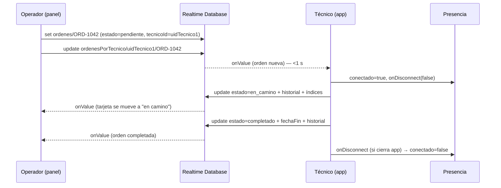

# MotoTrack / LiveControl — Diseño con Firebase Realtime Database

Adaptación del enfoque usado en NutriLaGuajira (offline-first + documentación +
reglas + servicios Flutter) al caso de **despacho y monitoreo de órdenes de
servicio en tiempo real**.

> **Idea central:** el operador crea/asigna una orden y el técnico la ve al
> instante; cuando el técnico cambia `pendiente → en_camino → completado`, el
> panel del operador se actualiza sin recargar. Si el técnico pierde señal, sus
> cambios se encolan en el dispositivo y se envían solos al reconectarse.

---

## 1. Por qué Realtime Database y no Firestore

| Criterio | Realtime Database | Firestore |
|---|---|---|
| Latencia de cambios | WebSocket persistente; pensado para actualizaciones frecuentes y pequeñas | Listeners también en tiempo real, pero con mayor sobrecarga por documento |
| Modelo | Árbol JSON plano, lectura/escritura por ruta | Documentos/colecciones, consultas compuestas |
| Presencia | Nativa con `.info/connected` + `onDisconnect()` | Requiere heartbeat + Cloud Functions |
| Offline | Caché en disco + cola de escrituras automática | Persistencia offline + cola |
| Costo con muchas actualizaciones | Se paga almacenamiento + ancho de banda | Se paga por lectura/escritura; los cambios de estado constantes suman operaciones |
| Consultas | Limitadas (`orderByChild`, `equalTo`, rangos simples, sin agregaciones) | Consultas compuestas, `count()`, agregaciones |
| Escala de datos | Un árbol (1 GB por base por defecto, sharding manual) | Colecciones grandes y consultas complejas |
| Ideal para | Despacho, estados, mapas, presencia, chats operativos | Reportes, catálogos, analítica, datos con muchas relaciones |

**Conclusión para MotoTrack:** RTDB es la elección correcta porque el núcleo del
producto son actualizaciones pequeñas y frecuentes (`estado`, `ubicacion`,
`presencia`) que deben llegar en menos de un segundo, con un modelo de datos
simple. Si más adelante se necesita reportería histórica compleja, se puede
complementar con Firestore/BigQuery sin migrar la operación en vivo.

---

## 2. Casos de uso

### Caso 1 — Despacho en tiempo real

El operador crea una orden y la asigna a un técnico. El teléfono del técnico
escucha `ordenesPorTecnico/{uid}` y recibe la orden nueva sin refrescar.

### Caso 2 — Cambios de estado instantáneos

El técnico cambia `pendiente → en_camino → completado`. El panel del operador
escucha `ordenes` (o `ordenesPorEstado`) y actualiza la tarjeta en vivo. Cada
cambio deja un registro en `historialEstados`.

### Caso 3 — Presencia y “última conexión”

Cada técnico mantiene `presencia/{uid}`. Al conectarse marca `conectado: true`;
`onDisconnect()` deja `conectado: false` y `ultimaConexion` cuando pierde señal,
cierra la app o se queda sin batería. El operador sabe a quién puede despachar.

### Caso 4 — Offline en ruta

El técnico entra a una zona sin cobertura. La app sigue mostrando la orden desde
la caché local y los cambios de estado se encolan. Al recuperar señal, RTDB
envía la cola automáticamente y el panel del operador recibe el estado final.

### Caso 5 — Panel del operador

Lista de órdenes por estado, mapa con la última ubicación de cada técnico y
alertas de técnicos desconectados. Todo con listeners de RTDB.

---

## 3. Modelo de datos (árbol JSON)

```text
raíz
├── usuarios/{uid}
│   ├── nombre, rol ("operador" | "tecnico"), telefono, activo
│
├── tecnicos/{uid}
│   ├── nombre
│   ├── estado ("disponible" | "ocupado" | "offline")
│   ├── ordenActiva (id o null)
│   └── ubicacion { lat, lng, actualizadoEn }
│
├── ordenes/{ordenId}
│   ├── titulo, descripcion, prioridad
│   ├── cliente { nombre, direccion, telefono }
│   ├── tecnicoId
│   ├── estado ("pendiente" | "en_camino" | "completado" | "cancelado")
│   ├── creadoPor
│   ├── fechaCreacion, fechaAsignacion, fechaInicio, fechaFin
│   ├── actualizadoEn
│   └── version
│
├── ordenesPorTecnico/{uid}/{ordenId}
│   ├── estado
│   └── actualizadoEn
│
├── ordenesPorEstado/{estado}/{ordenId}
│   ├── tecnicoId
│   └── actualizadoEn
│
├── historialEstados/{ordenId}/{eventoId}
│   ├── estado
│   ├── por (uid)
│   ├── en (timestamp del servidor)
│   └── nota (opcional)
│
└── presencia/{uid}
    ├── conectado (bool)
    ├── desde (timestamp)
    ├── ultimaConexion (timestamp)
    └── dispositivo ("Android" | "iOS" | "Web")
```

### Ejemplo de una orden

```json
{
  "ordenes": {
    "ORD-1042": {
      "titulo": "Mantenimiento preventivo nevera industrial",
      "descripcion": "Revisar compresor y limpiar condensador.",
      "prioridad": "alta",
      "cliente": {
        "nombre": "Tienda La Esperanza",
        "direccion": "Calle 15 # 8-42, Riohacha",
        "telefono": "+57 300 000 0000"
      },
      "tecnicoId": "uidTecnico1",
      "estado": "en_camino",
      "creadoPor": "uidOperador1",
      "fechaCreacion": 1732300000000,
      "fechaAsignacion": 1732300060000,
      "fechaInicio": 1732300300000,
      "fechaFin": null,
      "actualizadoEn": 1732300300000,
      "version": 3
    }
  },
  "ordenesPorTecnico": {
    "uidTecnico1": {
      "ORD-1042": { "estado": "en_camino", "actualizadoEn": 1732300300000 }
    }
  },
  "ordenesPorEstado": {
    "pendiente": {},
    "en_camino": { "ORD-1042": { "tecnicoId": "uidTecnico1", "actualizadoEn": 1732300300000 } },
    "completado": {},
    "cancelado": {}
  },
  "historialEstados": {
    "ORD-1042": {
      "-O3xYzA1": { "estado": "pendiente", "por": "uidOperador1", "en": 1732300000000 },
      "-O3xYzB2": { "estado": "en_camino", "por": "uidTecnico1", "en": 1732300300000 }
    }
  },
  "presencia": {
    "uidTecnico1": {
      "conectado": true,
      "desde": 1732300200000,
      "ultimaConexion": 1732300200000,
      "dispositivo": "Android"
    }
  }
}
```

### Decisiones del modelo

1. **Árbol plano con desnormalización controlada.** RTDB no tiene consultas
   compuestas: para listar rápido se mantienen `ordenesPorTecnico` y
   `ordenesPorEstado` como índices. Se actualizan en la misma operación
   multi-ruta que la orden (atómica).
2. **`ordenId` legible** (`ORD-1042`) o `push()` key. Se recomienda un id
   legible generado por el operador/servidor para trazabilidad.
3. **Timestamps numéricos** con `ServerValue.timestamp`, no strings, para
   ordenar y calcular tiempos.
4. **`version`** se incrementa en cada transición; sirve para auditoría y para
   detectar escrituras viejas.
5. **Historial append-only** en `historialEstados`: nunca se sobrescribe; cada
   evento conserva quién y cuándo.
6. **No duplicar la orden completa** en los índices: solo `estado`,
   `tecnicoId` y `actualizadoEn`, para que el `keepSynced` sea liviano.
7. **La ubicación va en `tecnicos/{uid}/ubicacion`**, no dentro de cada orden,
   para no generar escrituras masivas en el historial.

### Índices (`.indexOn`)

```json
{
  "ordenes": {
    ".indexOn": ["estado", "tecnicoId", "fechaCreacion", "prioridad"]
  },
  "presencia": {
    ".indexOn": ["conectado", "ultimaConexion"]
  }
}
```

---

## 4. Máquina de estados

```text
                 (operador asigna)
   [pendiente] ──────────────────────► [en_camino]
        │                                   │
        │ (operador cancela)                │ (técnico completa)
        ▼                                   ▼
   [cancelado]                        [completado]
        ▲
        └────────── (operador cancela desde en_camino)
```

| Transición | Quién | Efecto |
|---|---|---|
| `pendiente → en_camino` | Técnico asignado (o operador) | `fechaInicio`, presencia `ocupado`, `ordenActiva` |
| `en_camino → completado` | Técnico asignado | `fechaFin`, presencia `disponible`, `ordenActiva = null` |
| `pendiente/en_camino → cancelado` | Operador | Se libera al técnico |
| `pendiente → pendiente` (reasignar) | Operador | Cambia `tecnicoId` y actualiza índices |

**Validación:** las reglas de RTDB pueden validar el valor del estado y que el
técnico sea el asignado, pero una máquina de estados estricta (rechazar saltos
inválidos, por ejemplo `pendiente → completado`) se garantiza mejor con una
**Cloud Function** (`onUpdate` de `ordenes/{id}`) o con transacciones en línea.
El documento propone ambas capas:

- Cliente: deshabilita botones según el estado actual.
- Reglas: solo el técnico asignado o un operador pueden escribir; estado en
  lista blanca.
- Cloud Function (fase 2): valida transición, escribe historial y notifica.

---

## 5. Flujo en tiempo real



Listeners recomendados:

- Técnico:
  - `ordenesPorTecnico/{uid}` → lista de órdenes asignadas (liviana).
  - `ordenes/{id}` → detalle de la orden abierta.
  - `presencia/{uid}` → estado propio (opcional).
- Operador:
  - `ordenes` → todas las órdenes (o `ordenesPorEstado/{estado}`).
  - `tecnicos` y `presencia` → mapa y disponibilidad.
  - `historialEstados/{id}` → línea de tiempo de una orden.

---

## 6. Offline-first en ruta

### Caché y cola automática

```dart
// Antes de usar cualquier referencia.
FirebaseDatabase.instance.setPersistenceEnabled(true);
```

- RTDB guarda en disco las rutas activas y **encola las escrituras** hechas sin
  red. Al reconectar, las envía en orden.
- `keepSynced(true)` mantiene una ruta sincronizada incluso sin listeners:
  útil para las órdenes asignadas al técnico.

```dart
final db = FirebaseDatabase.instance;
db.ref('ordenesPorTecnico/$uid').keepSynced(true);
```

- La UI debe ser **optimista**: escribe primero y escucha el snapshot local;
  RTDB refleja el cambio de inmediato en la caché.

### Actualización atómica multi-ruta

Un cambio de estado debe tocar orden, índices e historial en una sola operación:

```dart
Future<void> cambiarEstado({
  required String ordenId,
  required String uidTecnico,
  required String estadoAnterior,
  required String estadoNuevo,
}) async {
  final db = FirebaseDatabase.instance;
  final eventoId = db.ref('historialEstados/$ordenId').push().key!;
  final ahora = ServerValue.timestamp;

  await db.ref().update({
    'ordenes/$ordenId/estado': estadoNuevo,
    'ordenes/$ordenId/actualizadoEn': ahora,
    'ordenesPorTecnico/$uidTecnico/$ordenId/estado': estadoNuevo,
    'ordenesPorTecnico/$uidTecnico/$ordenId/actualizadoEn': ahora,
    'ordenesPorEstado/$estadoAnterior/$ordenId': null,
    'ordenesPorEstado/$estadoNuevo/$ordenId': {
      'tecnicoId': uidTecnico,
      'actualizadoEn': ahora,
    },
    'historialEstados/$ordenId/$eventoId': {
      'estado': estadoNuevo,
      'por': uidTecnico,
      'en': ahora,
    },
  });
}
```

`update()` en la raíz es **atómico**: o se aplican todas las rutas o ninguna.
Offline, la operación se aplica a la caché y se encola completa.

### Conflictos

- RTDB resuelve por **última escritura gana** por ruta.
- `historialEstados` conserva todos los intentos (quién y cuándo).
- Para reglas de negocio estrictas, una Cloud Function o una transacción en
  línea valida la transición.
- **Importante:** las transacciones de RTDB **no se ejecutan offline**. Para
  cambios en campo se recomienda el `update()` multi-ruta + historial, no una
  transacción; la conciliación final la hace el servidor.

### Limitaciones a tener claras

- Los listeners mantienen la app actualizada **mientras está viva**. Si el
  técnico cierra la app, no hay actualización en tiempo real; para eso se
  necesita **FCM** (notificación push) que despierte la app.
- Un `onDisconnect` no se dispara si el sistema mata el proceso sin cerrar la
  conexión de inmediato; el servidor lo detecta tras el timeout de la conexión.
- El reloj del teléfono puede estar mal: usar `ServerValue.timestamp` para los
  campos de negocio.

---

## 7. Presencia con `onDisconnect`

```dart
class PresenceService {
  PresenceService({FirebaseDatabase? db})
      : _db = db ?? FirebaseDatabase.instance;

  final FirebaseDatabase _db;
  bool _registrado = false;

  void iniciar(String uid) {
    if (_registrado) return;
    _registrado = true;

    final presencia = _db.ref('presencia/$uid');
    final conectado = _db.ref('.info/connected');

    conectado.onValue.listen((evento) {
      final estaConectado = evento.snapshot.value == true;
      if (!estaConectado) return;

      // Se registra ANTES de marcar conectado: si el proceso muere, el
      // servidor ejecuta esta operación.
      presencia.onDisconnect().set({
        'conectado': false,
        'ultimaConexion': ServerValue.timestamp,
      });

      presencia.update({
        'conectado': true,
        'desde': ServerValue.timestamp,
        'ultimaConexion': ServerValue.timestamp,
        'dispositivo': 'Android',
      });
    });
  }

  Future<void> detener(String uid) async {
    await _db.ref('presencia/$uid').update({
      'conectado': false,
      'ultimaConexion': ServerValue.timestamp,
    });
    await _db.ref('presencia/$uid').onDisconnect().cancel();
  }
}
```

Buenas prácticas:

- Registrar `onDisconnect` **antes** de escribir `conectado: true`.
- Re-registrar al volver del background (`AppLifecycleState.resumed`).
- En el panel, mostrar “desconectado hace X minutos” usando `ultimaConexion`.
- Opcional: un Cloud Function programado marca como offline a quien no haya
  actualizado en N minutos (por si el `onDisconnect` no llegó).

---

## 8. Reglas de seguridad

Roles en `usuarios/{uid}/rol` (`operador` o `tecnico`). Reglas propuestas:

```json
{
  "rules": {
    ".read": false,
    ".write": false,

    "usuarios": {
      "$uid": {
        ".read": "auth != null && (auth.uid == $uid || root.child('usuarios').child(auth.uid).child('rol').val() == 'operador')",
        ".write": "auth != null && root.child('usuarios').child(auth.uid).child('rol').val() == 'operador'"
      }
    },

    "tecnicos": {
      ".read": "auth != null",
      "$uid": {
        ".write": "auth != null && (auth.uid == $uid || root.child('usuarios').child(auth.uid).child('rol').val() == 'operador')",
        "ubicacion": {
          ".write": "auth != null && auth.uid == $uid"
        }
      }
    },

    "ordenes": {
      ".read": "auth != null",
      ".indexOn": ["estado", "tecnicoId", "fechaCreacion"],
      "$ordenId": {
        ".write": "auth != null && (root.child('usuarios').child(auth.uid).child('rol').val() == 'operador' || (root.child('ordenes').child($ordenId).child('tecnicoId').val() == auth.uid && newData.child('tecnicoId').val() == auth.uid))",
        "estado": {
          ".validate": "newData.isString() && newData.val().matches(/^(pendiente|en_camino|completado|cancelado)$/)"
        },
        "actualizadoEn": {
          ".validate": "newData.isNumber()"
        }
      }
    },

    "ordenesPorTecnico": {
      "$uid": {
        ".read": "auth != null && (auth.uid == $uid || root.child('usuarios').child(auth.uid).child('rol').val() == 'operador')",
        ".write": "auth != null && (auth.uid == $uid || root.child('usuarios').child(auth.uid).child('rol').val() == 'operador')"
      }
    },

    "ordenesPorEstado": {
      ".read": "auth != null",
      "$estado": {
        "$ordenId": {
          ".write": "auth != null && (root.child('usuarios').child(auth.uid).child('rol').val() == 'operador' || root.child('ordenes').child($ordenId).child('tecnicoId').val() == auth.uid)"
        }
      }
    },

    "historialEstados": {
      "$ordenId": {
        ".read": "auth != null",
        "$eventoId": {
          ".write": "auth != null",
          ".validate": "newData.hasChildren(['estado', 'por', 'en']) && newData.child('por').val() == auth.uid"
        }
      }
    },

    "presencia": {
      ".read": "auth != null",
      "$uid": {
        ".write": "auth != null && auth.uid == $uid"
      }
    }
  }
}
```

Notas:

- Un técnico solo puede escribir **su** presencia, su ubicación y las órdenes
  que tenga asignadas.
- La escritura multi-ruta requiere permiso en **todas** las rutas. Por eso el
  técnico puede mover su orden entre `ordenesPorEstado` únicamente si sigue
  siendo el `tecnicoId` de la orden; no puede tocar las de otros.
- Las reglas no reemplazan la validación de negocio: para transiciones
  estrictas, usar Cloud Function.

---

## 9. Implementación Flutter propuesta

### Dependencias

```yaml
dependencies:
  firebase_core: ^3.x
  firebase_auth: ^5.x
  firebase_database: ^11.x
  connectivity_plus: ^7.x
  # opcional
  google_maps_flutter: ^2.x
  geolocator: ^14.x
```

### Estructura de archivos

```text
lib/
  main.dart
  app_services.dart
  data/
    models/
      orden.dart
      tecnico.dart
      evento_estado.dart
    ordenes_repository.dart
    tecnicos_repository.dart
  services/
    auth_service.dart
    presence_service.dart
    ubicacion_service.dart
    sync_status_service.dart
  screens/
    login_screen.dart
    tecnico/
      mis_ordenes_screen.dart
      detalle_orden_screen.dart
    operador/
      panel_ordenes_screen.dart
      mapa_tecnicos_screen.dart
```

### Repositorio de órdenes

```dart
class OrdenesRepository {
  OrdenesRepository({FirebaseDatabase? db})
      : _db = db ?? FirebaseDatabase.instance;

  final FirebaseDatabase _db;

  Stream<List<Orden>> ordenesDelTecnico(String uid) {
    return _db.ref('ordenesPorTecnico/$uid').onValue.map((evento) {
      final datos = evento.snapshot.value as Map<dynamic, dynamic>? ?? {};
      return datos.entries
          .map((e) => Orden.desdeIndice(e.key as String, e.value))
          .toList();
    });
  }

  Stream<Orden?> orden(String id) {
    return _db.ref('ordenes/$id').onValue.map(
          (evento) => evento.snapshot.value == null
              ? null
              : Orden.fromMap(
                  Map<String, dynamic>.from(
                    evento.snapshot.value as Map<dynamic, dynamic>,
                  ),
                ),
        );
  }

  Future<void> asignar({
    required String ordenId,
    required String tecnicoId,
    required String operadorId,
  }) async {
    final ahora = ServerValue.timestamp;
    await _db.ref().update({
      'ordenes/$ordenId/tecnicoId': tecnicoId,
      'ordenes/$ordenId/estado': 'pendiente',
      'ordenes/$ordenId/fechaAsignacion': ahora,
      'ordenes/$ordenId/actualizadoEn': ahora,
      'ordenesPorTecnico/$tecnicoId/$ordenId': {
        'estado': 'pendiente',
        'actualizadoEn': ahora,
      },
      'ordenesPorEstado/pendiente/$ordenId': {
        'tecnicoId': tecnicoId,
        'actualizadoEn': ahora,
      },
    });
  }
}
```

### Mostrar en vivo en el panel

```dart
StreamBuilder<List<Orden>>(
  stream: _repo.ordenesPorEstado('en_camino'),
  builder: (context, snapshot) {
    final ordenes = snapshot.data ?? const <Orden>[];
    return ListView(
      children: ordenes.map((o) => TarjetaOrden(orden: o)).toList(),
    );
  },
)
```

`onValue` entrega el estado inicial desde la caché y luego cada cambio del
servidor. No se necesita `setState` manual ni refrescar la pantalla.

---

## 10. Panel del operador (consultas)

```dart
// Todas las órdenes pendientes
FirebaseDatabase.instance
    .ref('ordenes')
    .orderByChild('estado')
    .equalTo('pendiente')
    .onValue;

// Órdenes de un técnico
FirebaseDatabase.instance
    .ref('ordenes')
    .orderByChild('tecnicoId')
    .equalTo(uidTecnico)
    .onValue;

// Técnicos conectados (filtrar en cliente o usar índice)
FirebaseDatabase.instance.ref('presencia').onValue;
```

Para el mapa, escuchar `tecnicos/{uid}/ubicacion` y pintar el último punto.
Actualizar la ubicación con un `throttle` (por ejemplo, cada 15–30 segundos o
cada 50 metros) para no saturar escrituras.

---

## 11. Pruebas recomendadas

1. **Emulador local:**
   ```bash
   firebase emulators:start --only auth,database
   ```
   Apuntar la app al emulador con `useDatabaseEmulator('localhost', 9000)`.
2. **Dos dispositivos/emuladores:** uno como operador, otro como técnico.
   Crear la orden y verificar que aparece sin refrescar.
3. **Modo avión:** cambiar el estado en el técnico; la UI debe actualizarse
   localmente. Recuperar red y verificar en el panel que llegó el estado final y
   el historial.
4. **Cerrar la app del técnico:** verificar que `presencia/{uid}/conectado`
   pasa a `false` y se actualiza `ultimaConexion` (puede tardar el timeout de
   conexión).
5. **Reglas:** probar que un técnico no puede escribir la orden de otro ni la
   presencia de otro. Se pueden usar las pruebas de `@firebase/rules-unit-testing`.
6. **Doble cambio simultáneo:** dos clientes cambian el estado; verificar que
   el historial conserva ambos eventos y que gana la última escritura.

---

## 12. Costos y límites (piloto)

- RTDB: 1 GB de almacenamiento y 10 GB/mes de descarga en la capa gratuita;
  después, almacenamiento y ancho de banda.
- Cada cambio de estado es una escritura multi-ruta pequeña; el panel descarga
  solo los nodos que escucha.
- `keepSynced(true)` en demasiadas rutas aumenta la descarga; limitarlo a las
  órdenes del técnico.
- Si el volumen de datos o las consultas crecen, complementar con Firestore
  para históricos/reportes.

---

## 13. Comparación con lo implementado en NutriLaGuajira

| NutriLaGuajira (Firestore) | MotoTrack / LiveControl (RTDB) |
|---|---|
| `FirebaseAuthService` | `AuthService` + rol en `usuarios/{uid}` |
| `FirestoreStrategy.sincronizar()` | `OrdenesRepository` + `update()` multi-ruta |
| `WriteBatch` de 400 | `DatabaseReference.update()` atómico |
| `alertas_criticas` global | `historialEstados` + `presencia` |
| `SyncManager` (conectividad) | `SyncStatusService` + `.info/connected` |
| SQLite como fuente de verdad | Caché RTDB + cola offline |
| `uuid` como id del documento | `ORD-xxxx` o `push()` key |
| “Última escritura gana” | Historial + transición validada |
| `firestore.rules` | Reglas JSON de RTDB |
| `firestore.indexes.json` | `.indexOn` por nodo |
| Sincronización unidireccional | Bidireccional en tiempo real |

---

## 14. Plan de implementación sugerido

**Fase 1 — Núcleo operativo**
- Auth con roles.
- Crear/asignar orden y listeners del técnico.
- Cambio de estado + historial + índices.
- Presencia con `onDisconnect`.

**Fase 2 — Robustez**
- Persistencia y `keepSynced`.
- Indicador de conexión/pendientes.
- Validación de transiciones con Cloud Function.
- FCM para avisar al técnico con la app cerrada.

**Fase 3 — Panel y métricas**
- Mapa de técnicos.
- Filtros por estado/prioridad.
- Reportes de tiempos por orden (historial).
- Exportación a Firestore/BigQuery si se requiere analítica.

---

## 15. Resumen

- **RTDB encaja** porque el caso es de baja latencia, árbol simple, escrituras
  pequeñas y presencia nativa.
- **La orden vive en `ordenes/{id}`**, con índices desnormalizados para listar
  rápido y `historialEstados` para auditoría.
- **El offline es automático** en RTDB; la app debe ser optimista y usar
  `update()` multi-ruta.
- **La presencia se resuelve con `onDisconnect`**, sin servidor propio.
- **Las reglas JSON** aíslan por rol y por técnico asignado.
- Si el producto crece en reportería o consultas complejas, se complementa con
  Firestore sin cambiar la operación en vivo.
